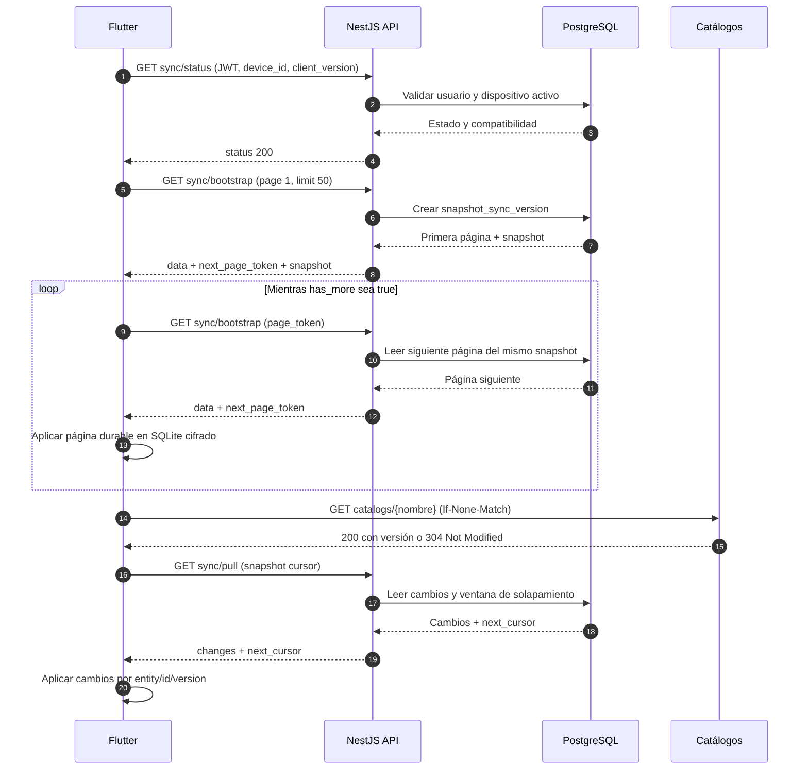
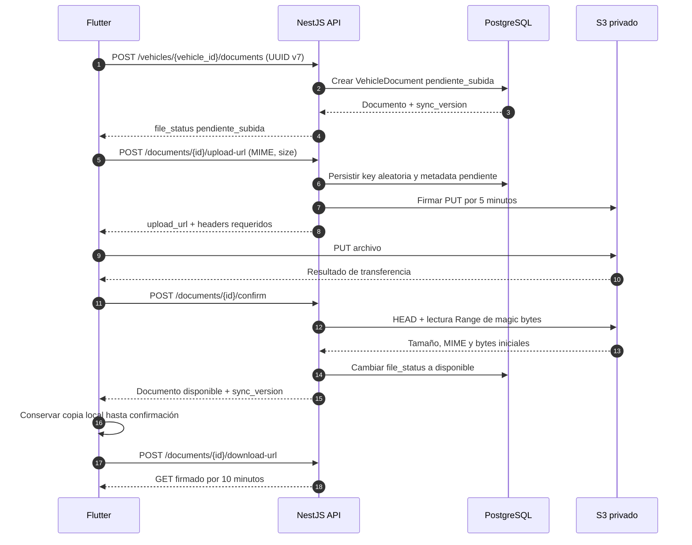
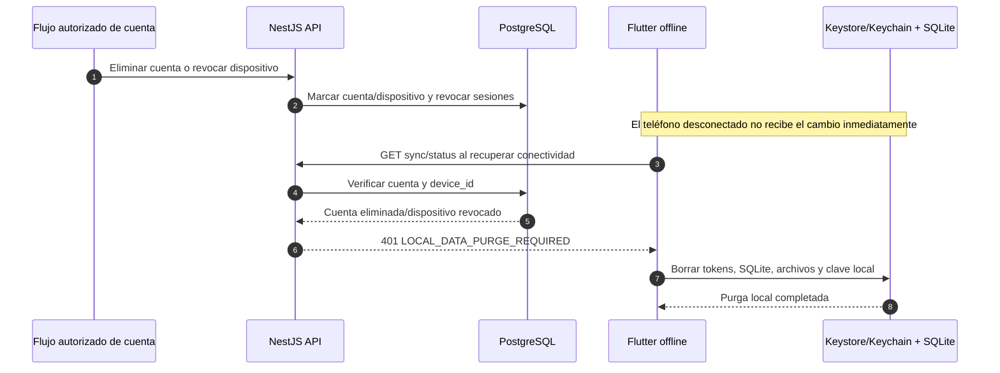

# Contrato de almacenamiento local y sincronización

**Producto:** aplicación móvil de gestión vehicular y asistencia en carretera para Nicaragua
**Versión:** 0.4.0
**Actualizado:** 2026-11-09
**Estado:** contrato implementado en el backend NestJS B5S; la app Flutter/SQLite no forma parte de esta fase
**Consumidores:** backend NestJS (fase B5S) y futura app Flutter + SQLite
**Documentos relacionados:** `architecture.md`, `data-dictionary.md`, `decisions.md`

> Este contrato define el comportamiento observable entre Flutter y `/api/v1`. El teléfono conserva una copia local mínima y cifrada para lectura/edición offline; PostgreSQL es la fuente de verdad final. El cliente nunca se conecta directamente a PostgreSQL, Redis ni a AWS S3 sin una URL firmada emitida por la API.
>
> Las decisiones confirmadas se describen como reglas. Las discrepancias de perfil, recordatorios, consentimiento y alcance se cerraron mediante D-060 a D-066 y se reflejan en el esquema, la migración y la API B5S.

## 1. Alcance y principios

1. El dispositivo mantiene únicamente los datos privados necesarios para que el usuario consulte y edite su información sin conectividad.
2. El servidor valida propiedad, permisos, relaciones, estados y versiones. Nunca confía en `user_id`, `sync_version`, `created_at`, `updated_at`, `deleted_at`, roles o estados administrativos enviados por el móvil.
3. El cliente crea UUID v7 para las entidades offline que admiten creación local. El servidor conserva ese ID o rechaza la mutación ante colisión; nunca sustituye silenciosamente el identificador.
4. El servidor asigna `sync_version` mediante trigger PostgreSQL y una secuencia global compartida. El cliente solo almacena y devuelve esa versión como dato opaco.
5. Toda escritura sincronizable se identifica con `mutation_id`. La repetición de una mutación ya procesada reproduce su resultado original.
6. Los borrados son lógicos en el servidor. El pull entrega tombstones para que el cliente oculte/elimine la copia funcional sin perder la versión necesaria para evitar resurrecciones por solapamiento.
7. La hora persistida por el servidor se expresa en UTC. Las reglas de calendario y horarios de usuario se interpretan en `America/Managua`.
8. La conectividad puede ser irregular. Las colas locales sobreviven cierres inesperados, reinicios y cambios de red.
9. Una solicitud de asistencia creada offline queda pendiente de envío, pero la UX nunca debe presentar la sincronización como sustituto de contactar inmediatamente al proveedor.
10. Todo dato patrocinado conserva `patrocinado: true`. Los anuncios expirados no se muestran, aunque estén almacenados en caché.

## 2. Modelo de almacenamiento local

### 2.1 Base local y protección

La app usa SQLite cifrado mediante SQLCipher o tecnología equivalente, con cifrado autenticado. La clave de la base se genera por instalación y se almacena en:

- Android: Android Keystore.
- iOS: Keychain, con atributos de protección adecuados al nivel de seguridad de la app.

Los tokens access/refresh se guardan exclusivamente en almacenamiento seguro del sistema; nunca en SQLite, preferencias sin cifrar, logs o archivos exportados. La base y los archivos privados se cifran también en reposo. La base local no debe incluir claves AWS, credenciales PostgreSQL, secretos de Twilio ni credenciales administrativas.

La apertura de la sección de documentos puede requerir PIN/biometría como control UX adicional. PIN/biometría no sustituye el cifrado ni la autenticación de la cuenta.

### 2.2 Datos privados sincronizados en ambos sentidos

| Conjunto local | Tabla/objeto lógico local | Dirección | Límite / comportamiento |
|---|---|---|---|
| Perfil propio | `local_profile` | Pull + push | Un único perfil de la cuenta activa. Solo campos expresamente editables. |
| Vehículos propios | `local_vehicles` | Pull + push | Todos los activos y tombstones aún necesarios para sync. |
| Metadatos de documentos propios | `local_vehicle_documents` | Pull + push | Incluye estado de archivo; no contiene URLs firmadas permanentes. |
| Pólizas propias | `local_insurance_policies` | Pull + push | Solo visible para la cuenta propietaria; valores sensibles cifrados en servidor y base local. |
| Preferencias de notificación | `local_notification_preferences` | Pull + push | Solo preferencias configurables por el usuario. |
| Contactos de emergencia personales | `local_emergency_contacts` | Pull + push | Teléfonos y datos personales en base cifrada. |
| Solicitudes de asistencia propias | `local_assistance_requests` | Pull + push | Últimas 20 solicitudes finalizadas/recibidas, más todas las pendientes de envío o con cambios sin confirmar. Las pendientes nunca se expulsan por límite. |

**No se replica el archivo binario en `/sync/push` ni `/sync/pull`.** Los metadatos del documento se sincronizan primero; la transferencia binaria sigue el flujo específico de archivos de la sección 8.

### 2.3 Datos de usuario de solo lectura

| Conjunto local | Tabla/objeto lógico local | Dirección | Regla |
|---|---|---|---|
| Recordatorios y calendario (`Reminder` / schedule) | `local_reminders`, `local_reminder_schedule` | Solo lectura desde servidor | El servidor los calcula a partir de documentos, vencimientos y preferencias. Flutter no crea, edita, pospone ni elimina recordatorios mediante `/sync/push`. |
| Historial de notificaciones (`NotificationLog`) | `local_notification_history` | Solo lectura desde servidor | El backend registra entregas. El cliente no inventa ni altera resultados de entrega. La cantidad local se limita mediante configuración de retención de caché. |

Los eventos de calendario que Flutter programa en el sistema operativo son una proyección local de `GET /reminders/schedule`, no la fuente de verdad ni una escritura sobre `Reminder`. `NotificationPreference` es sync-ready; las mutaciones se validan contra el contrato B4 y el cliente no escribe `Reminder` ni `NotificationLog`.

### 2.4 Catálogos públicos versionados

Los catálogos se descargan mediante `GET /catalogs/{nombre}` y se guardan localmente con su versión y ETag:

- aseguradoras (`insurers`);
- números oficiales de emergencia verificados (`emergency-numbers`);
- tipos de servicio (`service-types`);
- especialidades (`specialties`);
- departamentos (`departments`);
- municipios (`municipalities`);
- marcas de vehículos (`vehicle-brands`);
- modelos de vehículos (`vehicle-models`).

Los catálogos son de solo lectura para el cliente. Flutter nunca envía mutaciones para ellos. Un número de emergencia solo se incluye si su fuente oficial fue verificada; no se generan números de ejemplo ni se publican contactos marcados como no verificados.

### 2.5 Cachés temporales con expiración

| Caché | Contenido permitido | Límite | TTL | Regla de presentación |
|---|---|---:|---:|---|
| Última búsqueda de talleres | Máximo 50 resultados resumidos: ID, nombre, ubicación/dirección pública, teléfono, WhatsApp, categoría, rango estimado si existe, `patrocinado`, fechas de vigencia y datos mínimos de contacto | 50 registros | 7 días | Mostrar fecha de actualización/caché. No guardar reseñas completas ni métricas. Al vencer, retirar la caché de resultados como fuente vigente. |
| Paquete offline de emergencia de la zona | Proveedores cercanos y contactos públicos verificados: ID, nombre, categoría/tipo, teléfono de llamada, teléfono WhatsApp, referencia de ubicación, municipio/departamento, verificación y fecha de captura | Tamaño configurable | 7 días | Debe indicar cuándo fue actualizado. No afirmar disponibilidad actual si se está offline. |
| Anuncios patrocinados | ID, creatividad/asset autorizado, ubicación publicitaria, `patrocinado: true`, `valid_from`, `valid_until`, URL/acción permitida y versión | Tamaño configurable | 24 horas como máximo | Nunca mostrar si venció `valid_until`, venció el TTL o no puede verificarse con seguridad que sigue vigente. La falta de conectividad no prolonga la vigencia. |

Los cachés no son fuentes de verdad y se pueden reconstruir. Los anuncios nunca se muestran si están vencidos; cuando la hora local del dispositivo sea inválida o no confiable, la decisión segura es ocultarlos hasta validar vigencia con el servidor.

### 2.6 Datos que NO se guardan localmente

No persistir como datos de negocio offline:

- datos privados de otros usuarios;
- reseñas completas ni respuestas completas de reseñas;
- métricas de anuncios;
- pagos, facturas, comprobantes ni estados contables B2B;
- datos de administración, auditoría interna o moderación;
- tokens FCM de terceros, secretos, llaves de cifrado del backend o credenciales de proveedores;
- objetos internos de S3, claves de bucket o URLs firmadas como referencias permanentes.

El directorio público solo se conserva en los dos cachés limitados de las secciones 2.4 y 2.5. Una ficha de taller/proveedor no se descarga como una base completa de negocios.

### 2.7 Archivos locales

Los PDF e imágenes de pólizas/documentos pueden conservar una copia local cifrada. La app debe:

- mantener un límite de espacio configurable por instalación;
- mostrar el uso de almacenamiento;
- ofrecer “liberar caché” sin borrar datos del servidor;
- permitir quitar una copia local sin ejecutar el borrado lógico del documento remoto;
- conservar el archivo local durante una subida pendiente o interrumpida;
- borrar las copias privadas y sus claves locales al cerrar sesión o recibir una orden de purga de datos.

El límite numérico de almacenamiento queda configurable por entorno/app y se aprobará como parámetro de producto; no se fija una cifra arbitraria en este contrato.

### 2.8 Tablas técnicas locales recomendadas

Además de las tablas de contenido, la implementación Flutter necesita como mínimo:

| Tabla lógica | Campos mínimos | Propósito |
|---|---|---|
| `local_sync_state` | `account_id`, `device_id`, `last_cursor`, `bootstrap_snapshot`, `last_successful_sync_at`, `schema_version` | Estado de sincronización de la cuenta/dispositivo. |
| `local_sync_queue` | `mutation_id`, `entity`, `operation`, `entity_id`, `base_sync_version`, `payload`, `client_updated_at`, `depends_on_mutation_ids`, `queue_order`, `status`, `last_error` | Cola durable de mutaciones aún no confirmadas. |
| `local_entity_versions` | `entity`, `entity_id`, `sync_version`, `deleted_at` | Evita aplicar un cambio antiguo sobre uno más nuevo y evita resurrección de tombstones. |
| `local_catalog_meta` | `catalog_name`, `etag`, `catalog_version`, `downloaded_at` | Validación HTTP condicional y control de versiones. |
| `local_cache_meta` | `cache_key`, `cached_at`, `expires_at`, `source_version` | TTL y expiración verificable de cachés. |

Los nombres físicos de tablas SQLite pueden cambiar durante la implementación, pero su comportamiento y durabilidad son parte del contrato.

## 3. Identificadores, metadatos y versiones

### 3.1 UUID del cliente

- El cliente genera UUID v7 antes de persistir una nueva entidad offline. `mutation_id` también debe ser UUID v7 (el backend lo exige).
- El mismo ID se conserva en SQLite, `sync_queue`, requests y respuesta del servidor.
- El servidor comprueba que el ID no pertenece ya a otro usuario ni a otra entidad incompatible.
- Ante colisión, responde `409 ID_COLLISION`; no sustituye el ID ni revela datos de la cuenta propietaria del ID.
- La creación offline de un perfil no está permitida: el perfil corresponde a la identidad ya autenticada y su ID lo asigna el servicio de identidad.

### 3.2 `sync_version`

- Tipo SQL: `BIGINT`; formato JSON: string decimal para evitar pérdida de precisión en runtimes que no representan todos los enteros de 64 bits.
- Se asigna exclusivamente mediante trigger PostgreSQL que consume una secuencia global compartida por las tablas sincronizables.
- No se incluye en DTOs de escritura como valor aceptable; si el cliente lo envía, se ignora solo si el contrato de DTO así lo establece o se rechaza por validación estricta. La regla preferida es rechazarlo.
- Se devuelve en bootstrap, pull y resultados de push.
- El cliente compara versiones por entidad/ID y aplica un cambio solo si su `sync_version` es mayor que la versión local conocida.

Los huecos en la secuencia son normales. Las transacciones pueden confirmar fuera de orden; el cursor y el solapamiento se definen en la sección 4.

### 3.3 Fechas

Todos los instantes de API se serializan como ISO-8601 UTC con sufijo `Z`. Fechas civiles de vencimiento usan `YYYY-MM-DD`. `client_updated_at` es informativo para resolución de conflictos, no reemplaza `updated_at` del servidor.

### 3.4 Borrado lógico y tombstones

Una mutación `delete` marca `deleted_at` en el servidor y provoca una nueva `sync_version`. El pull devuelve el tombstone como:

```json
{
  "entity": "vehicle",
  "operation": "delete",
  "id": "0192f2a0-7d2a-7c11-9d5a-123456789abc",
  "data": null,
  "deleted_at": "2026-11-03T14:30:00Z",
  "sync_version": "48125"
}
```

El cliente deja de mostrar el registro, pero conserva su tombstone/version local en `local_entity_versions` para que un upsert antiguo reentregado por el solapamiento no lo resucite.

**Vigencia del cursor: 90 días.** Los cursores firmados expiran después de 90 días; además, el servidor puede invalidar cursores por debajo de `sync_retention_state.minimum_valid_cursor`. Un cursor vencido o invalidado recibe `410 SYNC_RESYNC_REQUIRED` y exige un bootstrap completo. B5S no purga físicamente tombstones: permanecen hasta que una política de retención posterior avance el cursor mínimo y ejecute la limpieza aprobada. La purga física de datos personales sigue sometida al flujo de privacidad/retención y a “validar con abogado local”.

## 4. Protocolo de sincronización

### 4.1 Convenciones comunes

Base path: `/api/v1`. Formato JSON con `snake_case`. Endpoints privados requieren `Authorization: Bearer <access_token>` y TLS. `device_id` es el ID UUID del dispositivo registrado en `SyncDevice`; se envía en el body/query según el endpoint. El backend verifica que el dispositivo pertenezca al usuario autenticado y no esté revocado.

Límites iniciales del protocolo:

- `limit` máximo: 50 registros/cambios por página;
- máximo: 50 mutaciones por lote `/sync/push`;
- límite de payload por mutación y tamaño total del lote se configuran en backend y se publican en `/sync/status`; si se exceden, se devuelve error de validación/tamaño;
- las respuestas siempre incluyen `server_time` UTC cuando el endpoint devuelve estado de sync.

Errores HTTP usan la forma uniforme del producto:

```json
{
  "code": "SYNC_RESYNC_REQUIRED",
  "message": "Es necesario sincronizar nuevamente los datos del dispositivo.",
  "details": {},
  "request_id": "req_01JBY8MZ6W6S8F3E7K9A"
}
```

### 4.2 `GET /api/v1/sync/bootstrap`

**Objetivo:** descargar el conjunto inicial de datos privados de la cuenta después del login, con paginación y un punto de referencia para iniciar pull incremental.

**Request**

Headers:

```http
Authorization: Bearer <access_token>
```

Query:

```text
GET /api/v1/sync/bootstrap?device_id=0192f2a0-7d2a-7c11-9d5a-123456789abc&limit=50&page_token=
```

| Parámetro | Tipo | Requerido | Regla |
|---|---|---:|---|
| `device_id` | UUID | Sí | Debe ser un `SyncDevice` activo del usuario autenticado. |
| `limit` | integer | No | Default 50; mínimo 1; máximo 50. |
| `page_token` | string | No | Token opaco devuelto por la página anterior; firmado/validado por el servidor. Ausente en la primera página. |

**Response 200**

```json
{
  "bootstrap_id": "0192f2a0-7d2a-7c11-9d5a-123456789abc",
  "snapshot_sync_version": "48125",
  "initial_cursor": "eyJ...firma...",
  "initial_cursors": {
    "all": "eyJ...firma...",
    "profile": "eyJ...firma...",
    "vehicles": "eyJ...firma...",
    "documents": "eyJ...firma...",
    "policies": "eyJ...firma...",
    "notification_preferences": "eyJ...firma...",
    "emergency_contacts": "eyJ...firma...",
    "assistance_requests": "eyJ...firma...",
    "reminders": "eyJ...firma..."
  },
  "data": {
    "profile": [],
    "vehicles": [],
    "vehicle_documents": [],
    "insurance_policies": [],
    "notification_preferences": [],
    "emergency_contacts": [],
    "assistance_requests": [],
    "reminders": []
  },
  "next_page_token": "eyJ...opaque...",
  "has_more": true,
  "server_time": "2026-11-03T14:30:00Z"
}
```

La primera respuesta establece un `snapshot_sync_version` fijo para todas las páginas de ese bootstrap. Cada página devuelve como máximo `limit` registros en total, siguiendo el orden determinista definido por el servidor. Las páginas siguientes repiten el mismo `bootstrap_id` y `snapshot_sync_version`; el cliente no inicia el pull incremental hasta completar todas las páginas.

Cuando `has_more=false`, `next_page_token=null`; la sesión temporal se elimina. El cliente persiste los cursores opacos `initial_cursors` únicamente después de aplicar durablemente todas las páginas. `snapshot_sync_version` es informativo y nunca se envía como cursor: `/sync/pull` solo acepta los tokens firmados. `initial_cursor` es el cursor del canal agregado `all`; para un canal independiente se usa el valor exacto de `initial_cursors[channel]`.

Reglas:

- Solo se devuelve información del dueño autenticado.
- `assistance_requests` incluye las últimas 20 solicitudes relevantes y las que el protocolo marque como pendientes/activas; la implementación debe conservar todas las mutaciones locales sin confirmar.
- Los catálogos se obtienen aparte por `GET /catalogs/{nombre}` y no se duplican en cada bootstrap.
- Los resultados de búsqueda, paquete offline de emergencia y anuncios se descargan mediante los endpoints de sus dominios; no son parte de la réplica transaccional.
- El perfil es una proyección de la identidad autenticada. No se puede crear ni cambiar `role`, `status` o teléfono desde bootstrap/sync.
- Si un bootstrap queda incompleto, el cliente puede reanudar con `page_token` mientras sea válido. Iniciar otro bootstrap sin `page_token` reemplaza la instantánea anterior de ese mismo dispositivo; no se mezclan páginas de snapshots distintos.

**Errores**

| HTTP | `code` | Cuándo |
|---:|---|---|
| 401 | `AUTH_REQUIRED` | Token inválido/expirado sin instrucción de purga. |
| 401 | `LOCAL_DATA_PURGE_REQUIRED` | Cuenta eliminada o acceso invalidado de forma que exige borrar la réplica local. |
| 403 | `DEVICE_NOT_OWNED` | `device_id` no pertenece a la cuenta autenticada. |
| 401 | `LOCAL_DATA_PURGE_REQUIRED` | Dispositivo revocado. |
| 409 | `BOOTSTRAP_TOKEN_INVALID` | Token de página alterado o incompatible con el snapshot. |
| 410 | `BOOTSTRAP_EXPIRED` | Snapshot/token demasiado antiguo; iniciar bootstrap nuevo. |
| 429 | `RATE_LIMITED` | Límite de solicitudes excedido. |

### 4.3 `GET /api/v1/sync/pull`

**Objetivo:** obtener cambios del servidor desde el último cursor aceptado, incluyendo upserts y tombstones.

**Request**

```http
GET /api/v1/sync/pull?device_id=0192f2a0-7d2a-7c11-9d5a-123456789abc&channel=vehicles&cursor=eyJ...firma...&limit=50
Authorization: Bearer <access_token>
```

| Parámetro | Tipo | Requerido | Regla |
|---|---|---:|---|
| `device_id` | UUID | Sí | Dispositivo activo y propio. |
| `cursor` | string opaco firmado | Sí | Token devuelto en `initial_cursors[channel]` o `next_cursor`. HMAC-SHA256, ligado a usuario, dispositivo y canal, con expiración. No aceptar BIGINT decimal ni reconstruir/editar el contenido. |
| `channel` | string | No | Default `all`; uno de `all`, `profile`, `vehicles`, `documents`, `policies`, `notification_preferences`, `emergency_contacts`, `assistance_requests`, `reminders`. Debe coincidir con el canal del token. |
| `limit` | integer | No | Default 50; máximo 50. |

**Response 200**

```json
{
  "channel": "vehicles",
  "changes": [
    {
      "entity": "vehicle",
      "operation": "upsert",
      "id": "0192f2a0-7d2a-7c11-9d5a-123456789abc",
      "data": {
        "alias": "Camioneta",
        "brand_id": "0192f2a0-7d2a-7c11-9d5a-123456789abd",
        "model_id": "0192f2a0-7d2a-7c11-9d5a-123456789abe",
        "model_year": 2018,
        "color": "Azul",
        "plate": "M 123-456"
      },
      "deleted_at": null,
      "sync_version": "48126"
    }
  ],
  "next_cursor": "eyJ...firma...",
  "has_more": false,
  "server_time": "2026-11-03T14:31:00Z"
}
```

Reglas:

- El orden de cambios es ascendente por `sync_version` y, como desempate, por `entity` + `id`.
- `operation` solo admite `upsert` o `delete`.
- `upsert` incluye el DTO de lectura de esa entidad, con campos sensibles descifrados solo para el propietario autorizado y nunca con metadata KMS/HMAC interna.
- `delete` es un tombstone: `data=null`, `deleted_at` no nulo y `sync_version` nuevo.
- El `next_cursor` representa el watermark que el servidor propone para la siguiente lectura. El cliente no debe incrementarlo ni restarle el solapamiento.
- El servidor reconsulta una ventana de solapamiento fija de **5,000 versiones de la secuencia global** al iniciar cada pull de canal. El cliente aplica un cambio por `(entity,id)` solo si `sync_version` entrante es superior a la versión local; por ello, las reentregas son seguras. Los canales mantienen cursores independientes en `sync_channel_states`.
- Si `has_more=true`, se invoca pull otra vez con `next_cursor` hasta terminar. El cursor solo se persiste como último cursor confirmado después de aplicar de forma durable todos los cambios de la respuesta.
- Una respuesta vacía también devuelve `next_cursor` y `server_time`.

**Solapamiento y commits fuera de orden:** PostgreSQL asigna secuencias antes del commit; un registro con versión menor puede confirmar después de que otro registro con versión mayor ya se haya leído. B5S reentrega una ventana fija de 5,000 versiones globales para reducir ese riesgo (D-062). El cliente deduplica por `(entity,id)` y solo aplica versiones superiores. Una ventana finita no garantiza por sí sola la captura de una transacción que confirme arbitrariamente tarde; antes de producción se debe observar la duración real de transacciones y evaluar un watermark basado en commits o una reconciliación completa periódica. No se debe afirmar que `MAX(sync_version)` elimina todos los riesgos de commit fuera de orden.

**Errores**

| HTTP | `code` | Cuándo |
|---:|---|---|
| 400 | `INVALID_CURSOR` | Cursor mal formado o de otro formato/versión. |
| 401 | `AUTH_REQUIRED` | Credenciales no válidas. |
| 401 | `LOCAL_DATA_PURGE_REQUIRED` | Cuenta eliminada o dispositivo revocado; borrar toda la información local protegida. |
| 403 | `DEVICE_NOT_OWNED` | Dispositivo ajeno. |
| 410 | `SYNC_RESYNC_REQUIRED` | Cursor vencido (90 días), por debajo del mínimo válido, no recuperable o versión de protocolo incompatible. |
| 429 | `RATE_LIMITED` | Límite excedido. |
| 503 | `SYNC_TEMPORARILY_UNAVAILABLE` | Servicio temporalmente no disponible; conservar cursor/cola y reintentar. |

### 4.4 `POST /api/v1/sync/push`

**Objetivo:** enviar un lote ordenado de mutaciones creadas en el dispositivo. Cada mutación se procesa de forma independiente y con idempotencia.

**Request**

```json
{
  "device_id": "0192f2a0-7d2a-7c11-9d5a-123456789abc",
  "mutations": [
    {
      "mutation_id": "0192f2a0-7d2a-7c11-9d5a-123456789abd",
      "entity": "vehicle",
      "operation": "upsert",
      "id": "0192f2a0-7d2a-7c11-9d5a-123456789abe",
      "base_sync_version": null,
      "data": {
        "nickname": "Camioneta",
        "brand_id": "0192f2a0-7d2a-7c11-9d5a-123456789abf",
        "model_id": "0192f2a0-7d2a-7c11-9d5a-123456789ac0",
        "model_year": 2018,
        "vehicle_type": "pickup",
        "color": "Azul",
        "plate": "M 123-456"
      },
      "client_updated_at": "2026-11-03T14:20:00Z",
      "depends_on_mutation_ids": []
    }
  ]
}
```

**Campos**

| Campo | Tipo | Regla |
|---|---|---|
| `device_id` | UUID | Obligatorio, propio y no revocado. |
| `mutations` | array | 1 a 50 elementos, en el orden que el cliente solicita aplicar. |
| `mutation_id` | UUID v7 | Obligatorio (el backend exige versión 7) y estable para todos los reintentos de esa mutación. No se reutiliza con otro payload. |
| `entity` | string | Debe pertenecer a la allow-list de entidades editables de este contrato. |
| `operation` | string | `upsert` o `delete`. |
| `id` | UUID | ID v7 creado por cliente para entidades que lo admiten; `profile` usa el ID de la cuenta devuelto por el servidor. |
| `base_sync_version` | string decimal o `null` | Última versión conocida por el cliente; se conserva para diagnóstico/resolución de UI, pero no actúa como compare-and-swap en B5S. La regla de conflicto actual usa `client_updated_at` frente a `updated_at` del servidor. `null` para creación nueva. |
| `data` | object o `null` | Campos editables de la entidad; `null` para `delete`. Lista blanca estricta por entidad. |
| `client_updated_at` | ISO-8601 UTC | Hora de la edición local; obligatoria para aplicar LWW. |
| `depends_on_mutation_ids` | UUID[] | Mutaciones del mismo lote que deben haber sido aplicadas antes; default `[]`. |

El cliente nunca envía `user_id`, `sync_version`, `created_at`, `updated_at`, `deleted_at`, campos de rol/estado del usuario, claves, hashes HMAC, metadata KMS, `file_object_key`, URLs firmadas ni métricas internas.

**Response 200**

```json
{
  "results": [
    {
      "mutation_id": "0192f2a0-7d2a-7c11-9d5a-123456789abd",
      "entity": "vehicle",
      "id": "0192f2a0-7d2a-7c11-9d5a-123456789abe",
      "status": "applied",
      "server_sync_version": "48127",
      "server_updated_at": "2026-11-03T14:31:00Z",
      "conflict_resolution": null,
      "reason": null,
      "server_data": {
        "alias": "Camioneta",
        "model_year": 2018
      }
    }
  ],
  "server_time": "2026-11-03T14:31:00Z"
}
```

Estados por mutación:

- `applied`: escritura aceptada; incluye la versión y representación autoritativa actual del servidor. Los fallos transitorios de base de datos/pool o las respuestas HTTP 5xx no se registran como rechazos idempotentes: la API devuelve `503 SYNC_TEMPORARILY_UNAVAILABLE` o un 5xx y el cliente conserva la mutación para reintentar con el mismo ID. Para `assistance_request` con `operation=delete`, el resultado es una cancelación (`status=cancelled`), no un borrado lógico del registro; se conserva el historial y el pull posterior entrega el estado actualizado como `upsert`.
- `conflict`: el servidor conserva la versión ganadora; devuelve `server_sync_version`, `server_updated_at`, `reason` y `server_data` para que el cliente actualice su copia local y resuelva/reintente si corresponde.
- `rejected`: mutación no válida o dependiente fallida; incluye `reason`, `server_sync_version` cuando exista y detalles de validación seguros.

**Orden, transacciones e idempotencia**

1. El backend valida el lote y el dispositivo.
2. Procesa mutaciones en el orden recibido.
3. Cada mutación se ejecuta en su propia transacción. Un fallo no revierte mutaciones independientes anteriores o posteriores.
4. Si una mutación listada en `depends_on_mutation_ids` no terminó en `applied`, la dependiente queda `rejected` con `MUTATION_DEPENDENCY_FAILED`.
5. También se comprueban dependencias mediante FK/propiedad real; `depends_on_mutation_ids` no reemplaza constraints.
6. Antes de ejecutar se consulta `ProcessedMutation` por `(user_id, mutation_id)`. Si existe y el hash del payload canónico coincide, se devuelve exactamente el resultado original sin repetir escritura ni efectos secundarios. Si el ID se reutiliza con otro payload, se devuelve `MUTATION_ID_REUSE`.
7. La creación/actualización del recurso y el registro del resultado idempotente se confirman en la misma transacción.
8. La clave de idempotencia sync es `mutation_id`; no se envía `Idempotency-Key` en este endpoint.

**Errores de lote**

| HTTP | `code` | Cuándo |
|---:|---|---|
| 400 | `INVALID_SYNC_BATCH` | JSON/lote mal formado. |
| 401 | `AUTH_REQUIRED` | Access token inválido/expirado. |
| 401 | `LOCAL_DATA_PURGE_REQUIRED` | Cuenta eliminada o dispositivo revocado. |
| 403 | `DEVICE_NOT_OWNED` | `device_id` ajeno. |
| 413 | `SYNC_BATCH_TOO_LARGE` | Más de 50 mutaciones o tamaño total por encima del límite configurado. |
| 429 | `RATE_LIMITED` | Límite excedido. |
| 503 | `SYNC_TEMPORARILY_UNAVAILABLE` | Fallo transitorio; mantener mutaciones y reintentar. |

Errores por elemento se devuelven como `status: rejected` o `status: conflict` dentro de `results`, no como fallo HTTP de todo el lote. Los códigos por entidad incluyen `VALIDATION_ERROR`, `ENTITY_NOT_SYNCABLE`, `ID_COLLISION`, `RESOURCE_NOT_FOUND`, `RESOURCE_NOT_OWNED`, `MUTATION_DEPENDENCY_FAILED`, `MUTATION_ID_REUSE`, `STALE_STATE`, `INVALID_STATE_TRANSITION` y `CATALOG_REFERENCE_INVALID`.

### 4.5 `GET /api/v1/catalogs/{nombre}`

**Objetivo:** descargar un catálogo público completo y evitar descargas repetidas cuando no ha cambiado.

Nombres permitidos: `insurers`, `emergency-numbers`, `service-types`, `specialties`, `departments`, `municipalities`, `vehicle-brands`, `vehicle-models`. `vehicle-models` acepta `brand_id`; `municipalities` acepta `department_id`. Ambos filtros son UUID válidos y no pueden combinarse.

```http
GET /api/v1/catalogs/emergency-numbers
If-None-Match: "emergency-numbers-12"
```

Response 200: `{ "catalog": "emergency-numbers", "catalog_version": "12", "items": [...] }` y `ETag: "emergency-numbers-12"`. Si coincide `If-None-Match`, devuelve `304 Not Modified` sin body. Para `emergency-numbers` únicamente se devuelven filas `verified=true AND is_active=true`; la API nunca muestra datos pendientes ni notas internas. Redis almacena respuestas por nombre, filtros y versión durante una hora; PostgreSQL conserva la fuente de verdad y cada cambio incrementa la versión mediante trigger.

### 4.5.1 `GET /api/v1/catalogs/status`

**Objetivo:** una sola llamada para saber qué catálogos cambiaron. Devuelve un mapa `catalogs` con `version`, `etag` y `updated_at` de todos los catálogos. El propio endpoint incluye un ETag calculado sobre el conjunto de versiones y responde `304` cuando `If-None-Match` coincide. El cliente compara las versiones locales y descarga únicamente los catálogos cuyo ETag cambió.

### 4.5.2 Administración de números de emergencia

- `GET /api/v1/admin/emergency-numbers`: admin; incluye pendientes/no activos.
- `POST /api/v1/admin/emergency-numbers`: admin; `verified=false` por defecto.
- `PATCH /api/v1/admin/emergency-numbers/:id`: admin; cualquier cambio de número/estado incrementa `emergency-numbers`.
- `DELETE /api/v1/admin/emergency-numbers/:id`: admin; desactivación lógica.

Para `verified=true` se exige `source_name`; el servidor fija `verified_at` y `verified_by_user_id`. Los seeds no agregan números telefónicos: se requiere validación previa contra fuente primaria. No se debe inferir un número por búsqueda informal o por memoria.

### 4.5.3 Contactos de emergencia y texto para compartir

- `GET/POST /api/v1/me/emergency-contacts` y `PATCH/DELETE /api/v1/me/emergency-contacts/:id` están limitados al dueño. El teléfono se cifra con AAD v2 vinculado a cuenta y contacto. El máximo de cinco contactos activos se valida en el servicio y con trigger transaccional PostgreSQL.
- `POST /api/v1/emergency/share-message` recibe `vehicle_id`, `latitude`, `longitude` y `reference`. Valida el vehículo del dueño, descifra temporalmente el teléfono de la cuenta y devuelve `message`, `map_url` y `whatsapp_url` (`wa.me/?text=...`). No persiste las coordenadas ni el mensaje.

### 4.6 `GET /api/v1/reminders/schedule`

**Objetivo:** entregar el calendario autoritativo para que Flutter programe notificaciones locales del sistema operativo.

**Request**

```http
GET /api/v1/reminders/schedule?from=2026-11-03T00:00:00Z&to=2027-02-01T00:00:00Z&timezone=America/Managua
Authorization: Bearer <access_token>
```

`from` y `to` son instantes UTC, `from < to`; `timezone` debe ser `America/Managua` en la primera versión. El rango máximo se configura en el servidor.

**Response 200**

```json
{
  "timezone": "America/Managua",
  "generated_at": "2026-11-03T14:31:00Z",
  "schedule_version": "48127",
  "items": [
    {
      "schedule_id": "sch_0192f2a07d2a7c119d5a123456789abc",
      "reminder_id": "0192f2a0-7d2a-7c11-9d5a-123456789abd",
      "vehicle_document_id": "0192f2a0-7d2a-7c11-9d5a-123456789abe",
      "title": "Vencimiento de circulación",
      "fire_at_utc": "2026-11-10T15:00:00Z",
      "fire_at_local": "2026-11-10T09:00:00-06:00",
      "status": "scheduled"
    }
  ]
}
```

Flutter puede usar `schedule_id` como identificador estable de la notificación local. Ante cambios en documentos o preferencias, al abrir la app, recuperar conectividad o recibir una señal de actualización debe volver a descargar schedule y reconciliar notificaciones locales. El cliente no cambia el estado del recordatorio en el servidor.

**Errores:** `400 INVALID_SCHEDULE_RANGE`, `400 INVALID_TIMEZONE`, `401 AUTH_REQUIRED`, `401 LOCAL_DATA_PURGE_REQUIRED`, `429 RATE_LIMITED`, `503 SCHEDULE_TEMPORARILY_UNAVAILABLE`.

### 4.7 `GET /api/v1/sync/status`

**Objetivo:** negociar compatibilidad del cliente, dispositivo, cursor y política de resincronización antes de iniciar operaciones.

**Request**

```http
GET /api/v1/sync/status?device_id=0192f2a0-7d2a-7c11-9d5a-123456789abc&client_version=1.0.0&platform=android
Authorization: Bearer <access_token>
```

**Response 200**

```json
{
  "protocol_version": 1,
  "supported": true,
  "device_id": "0192f2a0-7d2a-7c11-9d5a-123456789abc",
  "platform": "android",
  "client_version": "1.0.0",
  "server_time": "2026-11-03T14:31:00Z",
  "current_sync_version": "48127",
  "minimum_valid_cursor": "0",
  "has_local_cursor": true,
  "resync_required": false,
  "max_page_size": 50,
  "max_mutations_per_batch": 50,
  "max_mutation_bytes": 262144,
  "max_batch_bytes": 13107200,
  "cursor_validity_days": 90,
  "idempotency_retention_days": 180,
  "overlap_window_versions": "5000",
  "bootstrap_ttl_hours": 24,
  "channels": ["all", "profile", "vehicles", "documents", "policies", "notification_preferences", "emergency_contacts", "assistance_requests", "reminders"],
  "channel_manifest": {
    "all": ["profile", "vehicle", "vehicle_document", "insurance_policy", "notification_preference", "emergency_contact", "assistance_request", "reminder"],
    "profile": ["profile"],
    "vehicles": ["vehicle"],
    "documents": ["vehicle_document"],
    "policies": ["insurance_policy"],
    "notification_preferences": ["notification_preference"],
    "emergency_contacts": ["emergency_contact"],
    "assistance_requests": ["assistance_request"],
    "reminders": ["reminder"]
  },
  "channel_cursors": {
    "all": { "acknowledged_cursor": "48125", "last_pulled_at": "2026-11-03T14:31:00Z", "requires_resync": false },
    "profile": { "acknowledged_cursor": "0", "last_pulled_at": null, "requires_resync": false },
    "vehicles": { "acknowledged_cursor": "48125", "last_pulled_at": "2026-11-03T14:31:00Z", "requires_resync": false },
    "documents": { "acknowledged_cursor": "0", "last_pulled_at": null, "requires_resync": false },
    "policies": { "acknowledged_cursor": "0", "last_pulled_at": null, "requires_resync": false },
    "notification_preferences": { "acknowledged_cursor": "0", "last_pulled_at": null, "requires_resync": false },
    "emergency_contacts": { "acknowledged_cursor": "0", "last_pulled_at": null, "requires_resync": false },
    "assistance_requests": { "acknowledged_cursor": "0", "last_pulled_at": null, "requires_resync": false },
    "reminders": { "acknowledged_cursor": "0", "last_pulled_at": null, "requires_resync": false }
  },
  "catalogs_endpoint": "/api/v1/catalogs/{name}",
  "read_only_endpoints": ["/api/v1/reminders/schedule", "/api/v1/notifications"],
  "excluded_from_push": ["reminder", "notification_log", "insurer", "emergency_number", "service_type", "specialty", "department", "municipality", "vehicle_brand", "vehicle_model", "workshop", "workshop_specialty", "workshop_photo", "service_offering", "assistance_provider", "review", "review_reply", "ad_plan", "ad_slot", "ad_campaign", "ad_metric", "payment", "invoice", "payment_proof", "audit_log", "refresh_token", "device_token", "sync_device", "processed_mutation", "exchange_rate", "consent_log"]
}
```

`resync_required=true` indica que algún canal guardado quedó por debajo del cursor mínimo o fuera de la ventana de 90 días; el cliente debe realizar bootstrap completo. `channel_manifest` enumera las entidades incluidas en cada canal; `channel_cursors` expone el watermark reconocido por el servidor y la última lectura por canal solo como información de estado. **`acknowledged_cursor` no es un cursor utilizable por el cliente**: para `/sync/pull` se debe conservar y reenviar exclusivamente el token opaco de `initial_cursors[channel]` o `next_cursor`. `platform`, cuando se envía, debe coincidir con la plataforma registrada durante OTP; `client_version` se actualiza y devuelve en esta consulta.

**Errores:** `401 AUTH_REQUIRED`, `401 LOCAL_DATA_PURGE_REQUIRED`, `403 DEVICE_NOT_OWNED`, `429 RATE_LIMITED`, `503 SYNC_TEMPORARILY_UNAVAILABLE`.

### 4.8 Códigos de error y comportamiento de purga

| Código | HTTP | Acción del cliente |
|---|---:|---|
| `LOCAL_DATA_PURGE_REQUIRED` | 401 | Borrar todos los datos privados de la cuenta del dispositivo: SQLite, archivos privados locales, cachés asociados a la cuenta, cola, cursores y tokens. Invalidar la clave de cifrado local de esa cuenta. No intentar push/pull de nuevo. |
| `SYNC_RESYNC_REQUIRED` | 410 | No borrar tokens ni la cuenta; detener pull incremental y ejecutar bootstrap completo. Preservar las mutaciones locales no confirmadas en una zona de recuperación hasta reconciliarlas; no descartarlas silenciosamente. |
| `AUTH_REQUIRED` | 401 | Solicitar autenticación/renovación según el flujo normal. No purgar datos solo por un token expirado común. |
| `DEVICE_NOT_OWNED` | 403 | Detener sync del dispositivo; limpiar credenciales del dispositivo y solicitar una sesión/dispositivo válido. |
| `DEVICE_REVOKED` | 401/403 según transporte | La respuesta normalizada para la app será `LOCAL_DATA_PURGE_REQUIRED`; purga local completa. |
| `MUTATION_ID_REUSE` | 409 (resultado por mutación) | Error de integridad del cliente; no reutilizar mutation_id. Mantener el registro de error para diagnóstico sin incluir datos sensibles en logs. |

`LOCAL_DATA_PURGE_REQUIRED` es el código explícito que ordena la purga completa local. Un `401 AUTH_REQUIRED` por expiración ordinaria no significa que la cuenta haya sido eliminada y no debe disparar borrado automático.

## 5. Resolución de conflictos

### 5.1 Regla general: último escritor por registro

La política es LWW por registro, comparando `client_updated_at` de la mutación con el `updated_at` actual del servidor:

1. `base_sync_version` se conserva como dato de diagnóstico y contexto de interfaz; en B5S no funciona como compare-and-swap ni bloquea por sí solo una escritura.
2. El servidor compara `client_updated_at` efectivo con `updated_at` del registro actual.
3. Si `client_updated_at` supera la hora de recepción del servidor en más de 5 minutos, se limita a la hora actual del servidor para la comparación; no se acepta un timestamp futuro arbitrario.
4. Si el timestamp efectivo del cliente es estrictamente posterior al `updated_at` actual, gana el cliente y la respuesta es `applied` con `conflict_resolution: "client_won_lww"`.
5. Si es anterior o igual, gana el servidor y la respuesta es `conflict`, con la versión y los datos actuales del servidor para que Flutter actualice su copia.
6. El servidor siempre asigna `updated_at` y `sync_version`; no conserva `client_updated_at` como timestamp autoritativo.

La regla no permite que un cliente cambie propietario, estado administrativo, proveedor asignado, timestamps autoritativos, contadores ni campos que no aparezcan en la lista editable de su entidad.

### 5.2 Timestamps adelantados y atrasados

Un timestamp más de cinco minutos en el futuro se reemplaza para efectos de comparación por la hora actual del servidor. Un timestamp atrasado se conserva solo como evidencia de orden de edición; no reemplaza `updated_at` del servidor. Si existe conflicto y el cliente tiene un reloj muy atrasado, la política LWW puede favorecer al servidor; se informa el conflicto de forma visible y se devuelve el registro ganador.

### 5.3 Recordatorios

Los recordatorios son generados y recalculados por el servidor a partir de documentos/preferencias y reglas de vencimiento. Flutter solo consume schedule e historial. Cualquier intento de incluir `reminder` en `/sync/push` se rechaza con `ENTITY_NOT_SYNCABLE`.

### 5.4 Eliminaciones concurrentes

Un tombstone del servidor prevalece sobre una mutación de edición basada en una versión anterior, salvo que una política explícita de restauración (no incluida en este contrato) haya sido aprobada. El cliente no puede restaurar un registro enviando `deleted_at=null`; una restauración futura, si se habilita, deberá ser una operación y permiso específicos.

## 6. Especificación por entidad

Los nombres siguientes son valores `entity` de la API, no nombres obligatorios de tablas SQLite. Los campos `created_at`, `updated_at`, `deleted_at` y `sync_version` son metadatos del servidor y se devuelven en lecturas cuando apliquen. Nunca son modificables por el móvil.

### 6.1 Entidades bidireccionales

| Entidad (`entity`) | Dirección | Campos que viajan | Campos que el cliente puede modificar | Validaciones del servidor | Errores posibles |
|---|---|---|---|---|---|
| `profile` | Pull + push (proyección singleton) | `id`, `display_name`, `email` (no verificado), `created_at`, `updated_at`, `sync_version` | `display_name`, `email`; teléfono/rol/estado nunca | ID debe ser el del usuario autenticado; nombre y formato de email válidos; email sigue siendo dato de contacto no verificado (D-037); no aceptar cambio de teléfono/rol/estado; filtrar siempre por identidad JWT | `VALIDATION_ERROR`, `RESOURCE_NOT_OWNED`, `FIELD_NOT_MUTABLE`, `MUTATION_CONFLICT` |
| `vehicle` | Pull + push | `id`, `plate` (solo propietario), `brand_id`, `brand` (snapshot visible), `model_id`, `model` (snapshot visible), `model_year`, `color`, `vehicle_type`, `alias`, `vin` (solo propietario), `mileage_km`, `photo_status`, `photo_size_bytes`, `created_at`, `updated_at`, `deleted_at`, `sync_version` | `plate`, `brand_id`, `brand`, `model_id`, `model`, `model_year`, `color`, `vehicle_type`, `nickname`, `vin`, `mileage_km`. B2 recibe `nickname` en escritura y devuelve `alias` en lectura; B5S conserva exactamente esa convención. La foto usa flujo dedicado y no se muta desde `/sync/push` | UUID v7 único y no reutilizable tras tombstone; placa normalizada y única por dueño entre activos; año 1950–año Managua+1; kilometraje no negativo; marca/modelo pueden ser texto manual o catálogo; si hay `model_id` debe pertenecer a `brand_id`; placa/VIN cifrados con HMAC ciego en backend; estado/keys de foto server-managed; siempre filtrar por dueño | `ID_COLLISION`, `RESOURCE_RETIRED`, `MUTATION_ID_REUSE`, `PLATE_ALREADY_REGISTERED`, `VEHICLE_LIMIT_REACHED`, `CATALOG_REFERENCE_INVALID`, `VALIDATION_ERROR`, `RESOURCE_NOT_OWNED`, `MUTATION_CONFLICT` |
| `vehicle_document` | Pull + push (metadatos) | `id`, `vehicle_id`, `document_type`, `title`, `issuer_name`, `valid_from`, `valid_until`, `file_status`, `file_content_type`, `file_size_bytes`, `original_file_name`, `insurance_policy_id`, metadatos sync | Al crear: `vehicle_id`, `document_type`, `title`, `issuer_name`, `valid_from`, `valid_until`. En actualización: solo `document_type`, `title`, `issuer_name`, `valid_from`, `valid_until`; `vehicle_id` no se puede mover después de crear. Borrado lógico por mutación; nunca `file_status`, object keys, MIME/tamaño verificados ni URL | UUID v7; vehículo debe pertenecer al dueño; fechas coherentes; `file_status` solo lo cambia el flujo firmado tras verificar objeto; no aceptar key/URL del cliente | `ID_COLLISION`, `RESOURCE_NOT_OWNED`, `DOCUMENT_FILE_NOT_AVAILABLE`, `DOCUMENT_FILE_TYPE_NOT_ALLOWED`, `DOCUMENT_FILE_TOO_LARGE`, `MUTATION_CONFLICT` |
| `insurance_policy` | Pull + push | `id`, `vehicle_id`, `document_id`, `insurer`, `insurer_id` o `other_insurer_name`, `policy_number` (solo propietario), `valid_from`, `valid_until`, `deductible`, `premium`, `currency`, `claims_phone`, `history_status`, `previous_policy_id`, `archived_at`, metadatos sync | Al crear: `vehicle_id`, `document_id`, `policy_number`, `valid_from`, `valid_until`, `currency` y una opción de aseguradora. Al actualizar: aseguradora/nombre libre, número, vigencias, deducible, prima, moneda, teléfono de siniestros y `title` del documento asociado. Vehículo y documento no se pueden cambiar; `history_status` no es editable | UUID v7; mismo dueño/vehículo; insurer activo o nombre libre XOR; número cifrado AES-256-GCM con AAD v2; `valid_until > valid_from`; deducible/prima no negativos; `history_status` es server-managed (`active|archived`); renovación archiva anterior | `RESOURCE_NOT_OWNED`, `INSURER_SELECTION_INVALID`, `INSURER_NOT_AVAILABLE`, `DOCUMENT_VALIDITY_INVALID`, `ID_COLLISION`, `MUTATION_CONFLICT` |
| `notification_preference` | Pull + push | `id`, `category`, `enabled_offsets`, `preferred_time`, `push_enabled`, `local_enabled`, `in_app_enabled`, `timezone`, metadatos sync | `enabled_offsets`, `preferred_time`, `push_enabled`, `local_enabled`, `in_app_enabled` | Una preferencia activa `document_expiry` por cuenta; offsets únicos de `{30,15,7,1,0}`; hora `HH:mm`; zona `America/Managua`; el servidor regenera recordatorios derivados | `VALIDATION_ERROR`, `RESOURCE_NOT_OWNED`, `MUTATION_CONFLICT`, `FIELD_NOT_MUTABLE` |
| `emergency_contact` | Pull + push | `id`, `name`, `relationship_label`, `phone_e164`, `is_primary`, metadatos sync | `name`, `relationship_label`, `phone_e164`, `is_primary` | UUID v7; teléfono E.164 cifrado AAD v2 en servidor y cifrado local; máximo cinco activos por usuario; solo un contacto principal activo; propietario no modificable | `VALIDATION_ERROR`, `EMERGENCY_CONTACT_LIMIT_REACHED`, `DUPLICATE_PRIMARY_CONTACT`, `ID_COLLISION`, `MUTATION_CONFLICT` |
| `assistance_request` | Pull + push (creación y cambios permitidos del solicitante) | `id`, `vehicle_id`, `service_type_id`, `issue_description`, `address_reference_text`, coordenadas opcionales, `department_id`, `municipality_id`, `contact_phone` si aplica, `preferred_contact`, `status` server-managed (`created`, `sent`, `accepted`, `en_camino`, `completed`, `cancelled`), `assistance_provider_id` de solo lectura, `sent_at`, `accepted_at`, `en_camino_at`, `completed_at`, `cancelled_at` y metadatos sync | Al crear: `vehicle_id`, `service_type_id`, `issue_description`, `address_reference_text`, coordenadas, departamento/municipio, contacto alternativo, `preferred_contact`. Después: solo cancelación/edición en estados expresamente permitidos | Referencia textual de dirección obligatoria incluso con GPS; vehículo y catálogos válidos; coordenadas en rango; teléfono cifrado; estado/transiciones server-controlled; proveedor solo lo asigna servidor; máximo una solicitud activa por cuenta/vehículo (o una por cuenta cuando no se indica vehículo); validación de duplicados/abuso | `VALIDATION_ERROR`, `CATALOG_REFERENCE_INVALID`, `RESOURCE_NOT_OWNED`, `INVALID_STATE_TRANSITION`, `ASSISTANCE_ALREADY_SUBMITTED`, `MUTATION_CONFLICT` |

**Nota de B2 para `vehicle`:** `photo_status` y `photo_size_bytes` se pueden replicar como metadatos; `photo_object_key`, `photo_pending_object_key`, URLs firmadas y headers de subida nunca forman parte de la mutación sync. La foto usa `POST /vehicles/:id/photo/upload-url` y `POST /vehicles/:id/photo/confirm`. `brand`/`model` se conservan como snapshots de texto; `brand_id`/`model_id` son opcionales para permitir altas manuales cuando el catálogo no contiene la opción.

**Notas de seguridad/cifrado:** `plate`, `vin`, `document_number`, `policy_number`, `phone` y teléfonos alternativos viajan por HTTPS en DTOs del propietario según necesidad funcional, pero se almacenan cifrados en SQLite y en el backend. El backend no devuelve `{ciphertext, nonce, tag, encrypted_dek, key_version, hmac}`; esos campos son internos. El cliente no implementa la clave maestra AWS KMS.

**Nota sobre `profile`:** B5S implementa una proyección singleton de `users` con `sync_version` y trigger propio. El ID sigue siendo el ID de la cuenta creado por servidor y se reutiliza en la mutación `profile`; no se crea una identidad offline ni se permite escribir teléfono, rol, estado, OTP o sesiones. El correo permanece no verificado y no se usa para autenticación/recuperación.

### 6.2 Entidades de solo lectura en móvil

| Entidad | Dirección | Campos que viajan | Modificables por móvil | Validaciones / errores |
|---|---|---|---|---|
| `reminder` / `reminders/schedule` | Solo lectura | `id`, `vehicle_document_id`, `title`, `description`, `reminder_type`, `due_at`, `scheduled_at`, `lead_time_days`, `channel`, `status`, `sent_at`, `cancelled_at`, `sync_version` | Ninguno | Generado por servidor; rechazar en push (`ENTITY_NOT_SYNCABLE`); el calendario local se obtiene por `GET /reminders/schedule` |
| `notification_log` | Solo lectura | `id`, `reminder_id`, `channel`, `provider`, `status`, `sent_at`, `read_at`, `created_at`, `error_code` seguro | Ninguno | Nunca incluir token FCM, contenido sensible ni payload del proveedor; `ENTITY_NOT_SYNCABLE` |
| `insurer` | Catálogo, solo lectura | `id`, `name` | Ninguno | Catálogo versionado con ETag; `CATALOG_NOT_FOUND` |
| `emergency_number` | Catálogo, solo lectura | `id`, categoría, institución, número, fuente/verificación, vigencia | Ninguno | Solo registros verificados; no inventar números; catálogo versionado |
| `service_type` | Catálogo, solo lectura | `id`, nombre, descripción corta, estado/orden | Ninguno | Catálogo versionado |
| `specialty` | Catálogo, solo lectura | `id`, nombre, estado/orden | Ninguno | Catálogo versionado |
| `department` | Catálogo, solo lectura | `id`, nombre, código oficial si existe | Ninguno | Catálogo versionado |
| `municipality` | Catálogo, solo lectura | `id`, `department_id`, nombre, código oficial si existe | Ninguno | Debe pertenecer al departamento indicado; catálogo versionado |
| `vehicle_brand` | Catálogo, solo lectura | `id`, `name`, `is_active`, `sort_order` | Ninguno | Catálogo versionado |
| `vehicle_model` | Catálogo, solo lectura | `id`, `brand_id`, `name`, `vehicle_category`, `is_active` | Ninguno | Marca válida; catálogo versionado |

### 6.3 Entidades excluidas de la réplica offline del conductor

Estas entidades no se guardan como tablas completas locales ni forman parte del `entity` allow-list de `/sync/push` en este contrato. Solo pueden aparecer como proyecciones de caché permitidas o consultarse online mediante sus endpoints de dominio:

| Entidad/dominio | Tratamiento en móvil |
|---|---|
| `Workshop`, `WorkshopSpecialty`, `WorkshopPhoto`, `ServiceOffering` | No se descarga el directorio completo. Solo resultados de búsqueda resumidos (máx. 50, TTL 7 días). Para roles propietarios, la edición offline del negocio requiere contrato/fase aparte. |
| `AssistanceProvider` | No se replica el registro completo. Solo contactos públicos y verificados incluidos en el paquete offline de emergencia (TTL 7 días) o consulta online. |
| `Review`, `ReviewReply` | No guardar reseñas/respuestas completas en SQLite offline. Pueden consultarse online en vistas paginadas. |
| `AdPlan`, `AdSlot`, `AdCampaign`, `AdMetric` | Solo proyección de anuncios vigentes con `patrocinado: true` en caché de 24 h; no se guarda gestión de campañas ni métricas. |
| `Payment`, `Invoice`, `PaymentProof` | No se guardan en dispositivo de usuario conductor. Son operaciones B2B de anunciante/admin. |
| `AuditLog`, `RefreshToken`, `DeviceToken`, `SyncDevice`, `ProcessedMutation` | Nunca se replican como contenido offline del usuario. Son controles internos del servidor. |
| `ExchangeRate` | No requiere réplica sync; puede llegar como metadata informativa desde los endpoints que muestran equivalentes NIO, siempre con tasa/fuente/fecha. |
| `ConsentLog` | Evidencia server-only append-only. Nunca se replica localmente ni forma parte de `/sync/push` o `/sync/pull`; se consulta solo mediante la exportación autorizada. |

### 6.4 Discrepancias y límites fuera del alcance B5S

1. **Tablas de negocio:** `Workshop`, `AssistanceProvider`, `ServiceOffering`, `Review` y `ReviewReply` quedan fuera de la réplica del conductor. La edición offline por cuentas de negocio requiere contrato/fase independiente.
2. **Licencia personal:** B3 implementa `VehicleDocument.vehicle_id` obligatorio y la API crea documentos bajo un vehículo. Si la licencia debe pertenecer al perfil del conductor, se requiere un flujo de documento personal en una fase separada; ver F-054.
3. **Historial de notificaciones:** B5S no agrega una tabla de historial dentro del bootstrap; la consulta sigue por `GET /api/v1/notifications` y la retención móvil se configura en Flutter.

## 7. Ciclo de vida de la sincronización

### 7.1 Primer login y bootstrap

1. Antes de pedir OTP, el cliente genera un UUID v7 persistente para la instalación como `device_id`; el identificador es parte de la sesión y debe ser nuevo al cambiar de cuenta en el mismo dispositivo.
2. El usuario completa OTP y envía `device_id`, plataforma y aceptación de la versión vigente del consentimiento a `POST /api/v1/auth/otp/verify`. El servidor crea/valida `SyncDevice` dentro de la transacción de login y vincula el token a ese dispositivo.
3. Después del login, el cliente registra el token FCM con `POST /api/v1/me/devices`; no debe enviar el token FCM durante la verificación OTP.
4. La app consulta `GET /sync/status`.
5. Si la versión es compatible, ejecuta `GET /sync/bootstrap` hasta `has_more=false`.
6. Aplica cada página de forma transaccional en SQLite; nunca marca bootstrap terminado si hay páginas pendientes.
7. Descarga catálogos por ETag y crea cachés limitadas cuando exista conectividad.
8. Cuando `has_more=false`, guarda los `initial_cursors[channel]` opacos recibidos y ejecuta pull por canal. No construye cursores desde `snapshot_sync_version`; ese valor es informativo. Debe conservar cada token literalmente y avanzar solo el canal cuya respuesta terminó de aplicarse en SQLite.

### 7.2 Uso normal

El cliente ejecuta pull:

- al abrir la app o volver a primer plano;
- al recuperar conectividad;
- periódicamente cada X minutos mientras está en primer plano (intervalo configurable por versión/consumo; no ejecutar polling agresivo en segundo plano);
- después de acciones del servidor que puedan cambiar el schedule/directorio;
- al iniciar manualmente “Sincronizar ahora”.

El cliente ejecuta push inmediatamente después de encolar una mutación si hay conectividad. Sin red, conserva la mutación en `local_sync_queue`. Al recuperar red, procesa lotes en orden, respetando dependencias. Los reintentos usan backoff exponencial con jitter y se detienen ante errores permanentes (`rejected`, `LOCAL_DATA_PURGE_REQUIRED`, incompatibilidad de versión). No generar bucles de polling/reintento rápido.

Una sincronización exitosa actualiza cursor/estado solo después de confirmar en SQLite todos los cambios recibidos. La cola local solo elimina una mutación tras recibir y persistir su resultado idempotente.

### 7.3 Cierre de sesión

El endpoint `POST /api/v1/auth/logout` revoca la familia de refresh tokens y el dispositivo asociado. El cliente debe borrar tokens, SQLite cifrado y copias privadas locales al completar el cierre; la revocación remota también hace que peticiones posteriores de ese dispositivo reciban `LOCAL_DATA_PURGE_REQUIRED`.

Al cerrar sesión explícitamente:

1. detener jobs y notificaciones locales asociadas a la cuenta;
2. borrar tokens de almacenamiento seguro;
3. borrar SQLite, archivos privados y cachés asociados a la cuenta;
4. invalidar/rotar la clave local de cifrado para que copias residuales no puedan descifrarse;
5. conservar solo preferencias no personales de la app que no identifiquen a la cuenta.

### 7.4 Eliminación de cuenta y revocación de dispositivo

B1 devuelve `local_cleanup_code=LOCAL_DATA_PURGE_REQUIRED` en `DELETE /api/v1/me`. Las peticiones autenticadas posteriores con access/refresh JWT firmado de esa cuenta/dispositivo devuelven HTTP 401 `LOCAL_DATA_PURGE_REQUIRED` y `details.purge_local_data=true`, incluso si el JWT expiró. Una firma inválida devuelve `AUTH_REQUIRED`, porque no se puede confiar en su identidad. Si la limpieza S3 falla, la cuenta permanece `deletion_pending` y el mismo dispositivo puede reintentar solo `DELETE /api/v1/me`, incluso con access token vencido; las demás rutas quedan bloqueadas. La app debe ejecutar la purga completa descrita en 4.8.

**Caso dispositivo desconectado:** el servidor no puede borrar físicamente el teléfono mientras no existe conectividad. Puede intentar una notificación push de revocación como señal de mejor esfuerzo, pero no se depende de que FCM llegue. Al recuperar conectividad, la app debe comprobar `sync/status` antes de mostrar o sincronizar datos de cuenta; si recibe `LOCAL_DATA_PURGE_REQUIRED`, borra todo. Mientras está offline, la app no puede saber que la cuenta fue eliminada desde otro dispositivo; la limitación debe tratarse honestamente en el diseño de seguridad.

## 8. Diagramas de secuencia

### 8.1 Primer inicio y bootstrap paginado



### 8.2 Push offline, dependencias, conflicto e idempotencia

```mermaid
sequenceDiagram
    autonumber
    participant App as Flutter
    participant API as NestJS API
    participant DB as PostgreSQL

    App->>App: Crear registro offline y mutation_id
    App->>App: Guardar mutación en local_sync_queue
    Note over App: Sin red, conservar la cola durable
    App->>API: POST sync/push (lote ordenado)
    API->>DB: Buscar ProcessedMutation por mutation_id
    alt Mutación ya procesada y hash coincide
        DB-->>API: Resultado original
        API-->>App: applied/conflict/rejected original
    else Mutación nueva
        API->>DB: Validar dependencia, dueño y base_sync_version
        alt Versión actual coincide o cliente gana LWW
            API->>DB: Guardar entidad; trigger asigna sync_version
            API->>DB: Guardar resultado ProcessedMutation en misma transacción
            DB-->>API: Entidad y versión actual
            API-->>App: status applied + server_sync_version
        else Servidor gana LWW o validación falla
            API->>DB: Guardar resultado de conflicto/rechazo
            DB-->>API: Versión/estado actual
            API-->>App: status conflict/rejected + server_data
        end
    end
    App->>App: Persistir resultado antes de retirar mutación
    App->>API: GET sync/pull (next_cursor)
    API-->>App: Cambios incrementales y tombstones
```

### 8.3 Subida de documento mediante URL firmada



Si la carga se interrumpe, `file_status` permanece `pendiente_subida`. La app conserva el archivo local y solicita/reutiliza URL de subida cuando recupere conectividad.

### 8.4 Solicitud de asistencia creada sin conexión

```mermaid
sequenceDiagram
    autonumber
    participant Driver as Conductor
    participant App as Flutter
    participant Pack as Paquete offline
    participant OS as Teléfono / apps externas
    participant API as NestJS API

    Driver->>App: Crear solicitud de auxilio
    App->>App: Guardar UUID v7 y estado pending_envio
    App->>Pack: Leer contactos locales y fecha de actualización
    Pack-->>App: Proveedores y teléfonos almacenados
    App-->>Driver: Mostrar llamada y WhatsApp
    Driver->>App: Elegir contacto
    App->>OS: Abrir marcador o WhatsApp con contacto
    Note over App: La solicitud sigue pendiente; no afirmar que fue despachada
    App->>API: POST sync/push al recuperar señal
    API-->>App: applied/rejected + estado de servidor
    App-->>Driver: Mostrar resultado real de envío
```

### 8.5 Cuenta eliminada o dispositivo revocado mientras está offline



## 9. Contrato de transferencia de archivos

### 9.1 Estados visibles

El valor autoritativo de `file_status` para documentos B3 es:

- `pendiente_subida`: metadato creado; la subida no ha sido confirmada por el servidor.
- `disponible`: el backend verificó el objeto real, su tamaño, MIME y firma mágica.

Flutter puede mostrar `uploading` como estado efímero local, pero no lo envía como estado de servidor. No se marca `disponible` por el simple hecho de que el PUT haya terminado.

### 9.2 Flujo de subida en tres pasos

**Paso 1 — Registrar documento:**

```http
POST /api/v1/vehicles/{vehicle_id}/documents
Authorization: Bearer <access_token>
Content-Type: application/json
```

Request:

```json
{
  "id": "018bcfe5-6800-7abc-8def-0123456789ab",
  "document_type": "circulacion",
  "title": "Circulación 2026",
  "issuer_name": "Autoridad emisora",
  "valid_from": "2026-01-01",
  "valid_until": "2026-12-31"
}
```

La API conserva el UUID v7 del cliente, filtra por propietario y devuelve `file_status: "pendiente_subida"`. Si se reenvía el mismo UUID y payload, devuelve el registro existente; si el payload difiere, responde conflicto.

**Paso 2 — Solicitar URL y subir:**

```http
POST /api/v1/documents/{document_id}/upload-url
Authorization: Bearer <access_token>
Content-Type: application/json
```

Request:

```json
{
  "content_type": "application/pdf",
  "size_bytes": 245760,
  "file_name": "circulacion.pdf"
}
```

Response 200:

```json
{
  "document_id": "018bcfe5-6800-7abc-8def-0123456789ab",
  "file_status": "pendiente_subida",
  "upload_url": "https://s3.example.invalid/signed-object-url",
  "expires_in_seconds": 300,
  "required_headers": { "Content-Type": "application/pdf", "Content-Length": "245760" },
  "simulated": false
}
```

Tipos aceptados exactamente: `application/pdf`, `image/jpeg`, `image/png`, `image/heic`. Máximo 10 MiB (10,485,760 bytes). El backend genera una object key aleatoria; Flutter nunca la elige ni la recibe. PUT firmado dura 5 minutos. Mientras siga vigente, la API no emite otra URL para esa key; después de expirar, una nueva solicitud genera una key distinta para impedir que la URL anterior sobrescriba el objeto que se confirmará. Si la URL expira, se solicita otra; mientras exista una carga pendiente, el MIME y tamaño deben coincidir con los metadatos pendientes.

**Paso 3 — Confirmar subida:**

```http
POST /api/v1/documents/{document_id}/confirm
Authorization: Bearer <access_token>
```

Response 200 (resumen):

```json
{
  "id": "018bcfe5-6800-7abc-8def-0123456789ab",
  "file_status": "disponible",
  "file_content_type": "application/pdf",
  "file_size_bytes": "245760",
  "sync_version": "42"
}
```

El backend comprueba HEAD de S3, tamaño real, MIME declarado y firma mágica de los primeros bytes para PDF/JPEG/PNG/HEIC. En producción no confirma si no puede inspeccionar el contenido real. Si la carga fue interrumpida o no se confirmó, permanece `pendiente_subida`; Flutter conserva su copia local y reintenta.

Errores: `DOCUMENT_NOT_FOUND`, `DOCUMENT_FILE_TYPE_NOT_ALLOWED`, `DOCUMENT_FILE_TOO_LARGE`, `DOCUMENT_FILE_SIZE_MISMATCH`, `DOCUMENT_FILE_TYPE_MISMATCH`, `DOCUMENT_FILE_CONTENT_UNVERIFIED`, `DOCUMENT_UPLOAD_NOT_STARTED`, `DOCUMENT_FILE_NOT_AVAILABLE`, `DOCUMENT_UPLOAD_ALREADY_PENDING`, `STORAGE_OBJECT_NOT_FOUND`, `STORAGE_OBJECT_NOT_VERIFIED`, `DOCUMENT_FILE_INSPECTION_FAILED`, `STORAGE_SIGNING_UNAVAILABLE`, `LOCAL_DATA_PURGE_REQUIRED`.

### 9.3 Descarga

```http
POST /api/v1/documents/{document_id}/download-url
Authorization: Bearer <access_token>
```

Response:

```json
{
  "document_id": "018bcfe5-6800-7abc-8def-0123456789ab",
  "download_url": "https://s3.example.invalid/signed-download-url",
  "expires_in_seconds": 600,
  "simulated": false
}
```

El backend verifica propietario y `file_status=disponible`; GET firmado dura 10 minutos. No se devuelve la object key. Flutter mantiene la URL cifrada solo temporalmente y solicita otra al expirar. La copia descargada permanece cifrada en almacenamiento privado del dispositivo.

### 9.4 Pólizas e historial

`POST /api/v1/vehicles/{vehicle_id}/policies` crea `InsurancePolicy` y su `VehicleDocument` asociado, ambos con UUID v7 del cliente. Se exige una aseguradora del catálogo o `other_insurer_name`, vigencia válida, número de póliza y moneda USD/NIO. El número y teléfono de siniestros se devuelven descifrados únicamente al propietario autenticado por TLS; no se registran en logs.

Al renovar, el backend archiva la póliza anterior, crea una nueva fila y conserva `previous_policy_id`. El historial se consulta con `GET /api/v1/vehicles/{vehicle_id}/policies`; no se sobrescribe la vigencia anterior. `Insurer` se descarga por `GET /api/v1/catalogs/insurers` con ETag.

## 10. Asistencia sin internet: regla obligatoria de UX

Cuando el usuario inicia una solicitud sin conexión:

1. Flutter crea un UUID v7 y guarda localmente la solicitud con estado local `pending_envio`.
2. La solicitud incluye como mínimo `service_type_id`, descripción, vehículo opcional y `address_reference_text` obligatorio. Las coordenadas GPS son complementarias, nunca sustituyen la referencia textual (“de la rotonda, 2 cuadras al lago”).
3. La app la encola para `/sync/push` al recuperar señal. El servidor la registra como `created`; una vez que la cobertura fue validada y BullMQ despacha el aviso pasa a `sent`. Si no hay cobertura o GPS, no se afirma que un proveedor recibió la solicitud.
4. La app muestra claramente “Pendiente de envío”; no afirma que un proveedor recibió la solicitud ni que la asistencia fue despachada.
5. **Siempre ofrece acciones visibles de llamada directa y WhatsApp** usando el paquete offline de emergencia vigente (proveedores cercanos y sus teléfonos verificados). La acción de llamada usa el marcador del sistema; WhatsApp abre el canal/contacto con mensaje prellenado si el sistema/app lo permite.
6. La app informa que una solicitud pendiente no ha sido enviada al proveedor y que la conexión telefónica/WhatsApp depende de cobertura y disponibilidad del dispositivo.
7. Cuando vuelve la conectividad, se envía la solicitud y se actualiza su estado según la respuesta del servidor.

El paquete offline vence a los 7 días. Si está vencido, la app no debe afirmar que sus datos siguen vigentes. Debe mostrar la fecha de última actualización y, cuando sea posible, refrescarlo. Para no bloquear la UX de emergencia, los contactos que aún estén almacenados pueden seguir ofreciendo las acciones directas de llamada y WhatsApp con una advertencia visible de datos desactualizados y confirmación del usuario; no se debe afirmar disponibilidad actual. Si no existe un número de contacto almacenado y verificable, no se inventa uno ni se crea una falsa acción de llamada.

## 11. Seguridad local y protección de cuenta

- SQLite cifrado; archivos privados cifrados; claves en Keystore/Keychain.
- Tokens JWT únicamente en almacenamiento seguro del sistema.
- TLS obligatorio hacia API y HTTPS firmado para S3.
- No registrar contenido de pólizas, placas, VIN, teléfonos, tokens o URLs firmadas en logs locales/remotos.
- Las respuestas de pull respetan autorización del usuario y no incluyen campos internos de cifrado.
- PIN/biometría opcional para abrir documentos.
- Cerrar sesión = purga local completa de la cuenta.
- `LOCAL_DATA_PURGE_REQUIRED` = purga local completa.
- Revocación de dispositivo = bloquear sync y ordenar purga local.
- Un `401 AUTH_REQUIRED` ordinario por expiración de access token no debe borrar automáticamente los datos; primero se intenta refresh/reautenticación según el flujo permitido.
- Exportación de cuenta y eliminación siguen el flujo de privacidad separado; no se implementan como borrado físico desde el cliente offline.

## 12. Casos de prueba de referencia para backend

### Caso 1 — Crear vehículo offline y sincronizar

**Preparación:** usuario autenticado y dispositivo registrado; catálogo de marca/modelo previamente descargado.
**Acción:** el usuario crea vehículo offline con UUID v7; Flutter encola `mutation_id`, `base_sync_version=null` y `client_updated_at`; recupera conectividad y llama `/sync/push`.
**Resultado esperado:** `status=applied`, el servidor conserva exactamente el UUID del cliente, asigna `sync_version` global por trigger, fija timestamps de servidor y el vehículo aparece en `/sync/pull` para el mismo y otros dispositivos del dueño. Si hay colisión, `ID_COLLISION` y no se sustituye el ID.

### Caso 2 — Editar el mismo registro desde dos dispositivos

**Preparación:** dispositivo A y B tienen vehículo con `sync_version=n`.
**Acción:** A y B editan offline; A sincroniza primero y el servidor produce `n+1`; B envía su mutación con `base_sync_version=n`.
**Resultado esperado:** el servidor detecta versión base obsoleta y aplica LWW usando `client_updated_at` efectivo. Si B tiene timestamp estrictamente posterior, gana B y recibe `applied` con `client_won_lww` y nueva versión; si no, B recibe `conflict`, versión actual y `server_data`. Ambos dispositivos convergen tras pull. Un reloj adelantado más de 5 minutos se limita a `server_time`.

### Caso 3 — Reenviar un lote duplicado

**Preparación:** lote válido con dos mutaciones y sus `mutation_id`.
**Acción:** el backend procesa y responde; por pérdida de respuesta el cliente reenvía exactamente el mismo lote.
**Resultado esperado:** el backend encuentra `ProcessedMutation`, devuelve los resultados originales, no crea filas duplicadas, no genera nuevas `sync_version` ni repite efectos externos. Si un `mutation_id` se reutiliza con payload distinto, devuelve `MUTATION_ID_REUSE` para esa mutación.

### Caso 4 — Cliente con cursor expirado

**Preparación:** el último uso del cursor ocurrió hace más de 90 días. B5S todavía no elimina físicamente tombstones; el token opaco ya expiró por política de vigencia.
**Acción:** cliente llama `/sync/pull` con el cursor vencido.
**Resultado esperado:** HTTP 410 `SYNC_RESYNC_REQUIRED`, con indicación de bootstrap completo. El cliente conserva temporalmente mutaciones no confirmadas en área de recuperación, completa bootstrap nuevo, compara versiones y reconcilia; no descarta escrituras pendientes silenciosamente ni intenta continuar con cursor antiguo.

### Caso 5 — Subida de archivo interrumpida

**Preparación:** metadato de documento creado/sincronizado; archivo local cifrado.
**Acción:** cliente pide URL, sube parcialmente o pierde red, y no logra completar la confirmación.
**Resultado esperado:** documento no pasa a `available`; servidor no lo entrega como descargable. El archivo local permanece. Al reconectar, el cliente obtiene URL nueva si la anterior expiró, vuelve a subir y llama complete. Solo después de verificación real pasa a `available`; entonces puede borrar la copia temporal local si la política de caché lo permite.

### Caso 6 — Cuenta eliminada mientras el dispositivo está desconectado

**Preparación:** el dispositivo tiene datos offline cifrados y queda sin red; desde otro canal se elimina la cuenta y el backend revoca tokens/dispositivos.
**Acción:** el dispositivo recupera conectividad y llama primero `/sync/status` o un endpoint autenticado de sync.
**Resultado esperado:** backend responde HTTP 401 `LOCAL_DATA_PURGE_REQUIRED`; la app borra SQLite, archivos privados, cachés, cola, cursores y tokens, e invalida la clave local. Mientras el dispositivo permanece desconectado no se afirma que el servidor pueda borrar remotamente sus datos; una notificación push de revocación es solo mejor esfuerzo.

## 13. Decisiones aplicadas por B5S y pendientes ajenos a esta fase

### Decisiones aprobadas e implementadas en backend

- Perfil propio como proyección singleton de `User`; identidad e ID siguen siendo server-generated (D-060). El trigger conserva `users.updated_at` y `users.sync_version` ante cambios exclusivos de login/OTP para que no alteren el LWW de perfil.
- B5S cubre exclusivamente cuentas conductor; los flujos de taller/proveedor offline requieren contrato separado (D-061).
- Pull por canal con solapamiento fijo de 5,000 versiones; reentregas esperadas y deduplicación local por entidad/ID/versión (D-062).
- Resultados de `ProcessedMutation` cifrados y conservados al menos 180 días; sin purga automática en esta fase (D-063).
- Parámetros backend: 50 elementos por página, 50 mutaciones por lote, 256 KiB por mutación, 12.5 MiB por lote, bootstrap 24 h y cursores con vigencia de 90 días (D-064). B5S no purga físicamente tombstones.
- Cursor y token de página HMAC firmados, opacos y ligados a usuario/dispositivo/canal o sesión de bootstrap (D-066). La firma utiliza la clave JWT configurada; una rotación de esa clave invalida cursores y páginas pendientes y obliga al cliente a iniciar bootstrap.
- Estado de cursor independiente por dispositivo y canal con `sync_channel_states` (D-065).
- `Reminder`/`NotificationLog` y catálogos son de solo lectura; `ConsentLog` es server-only (D-022, D-032).
- `file_status` es el nombre canónico público: `pendiente_subida` y `disponible` (D-051).
- El cursor expira por inactividad a los 90 días; los tombstones no se purgan físicamente en B5S. `sync_retention_state` permite que una futura política de retención avance el cursor mínimo. Las sesiones de bootstrap vencidas se limpian de forma oportunista al iniciar otro bootstrap del mismo dispositivo; no hay tarea de limpieza programada.

### Pendientes que permanecen fuera de la implementación B5S

1. Catálogo `Insurer`: puede permanecer vacío hasta contar con lista verificada antes de producción.
2. Retención local del historial de notificaciones y el límite numérico de almacenamiento privado son parámetros de producto/Flutter; el backend no inventa cifras.
3. Intervalo de pull en primer plano se configura en la app según consumo/conectividad; el backend no impone polling.
4. La ventana de 5,000 versiones reduce el riesgo de commits tardíos, pero no garantiza capturar transacciones arbitrariamente largas; requiere observabilidad y revisión operativa antes de producción.
5. La licencia de conducir sigue modelada bajo vehículo en B3; cualquier modelo de documento personal requiere fase propia (F-054).

---

**Fin del contrato.** La implementación NestJS B5S se encuentra en `src/modules/sync/`; la app Flutter/SQLite no está incluida en este repositorio backend. Cualquier cambio de comportamiento debe actualizar este documento y `decisions.md` antes de implementarse.

## Extensión B3 — Documentos y pólizas

### Clasificación y dirección

| Entidad | Dirección | Puede modificar el cliente | Server-managed |
|---|---|---|---|
| `VehicleDocument` | Bidireccional, sync-ready | `document_type`, `title`, `issuer_name`, `valid_from`, `valid_until`, ID UUID v7 | `user_id`, `file_status`, keys S3, MIME/tamaño verificados, timestamps, `sync_version` |
| `InsurancePolicy` | Bidireccional, sync-ready | aseguradora o nombre libre, número de póliza, vigencias, deducible, prima, moneda, teléfono de siniestros | `user_id`, historial/archivo por renovación, AAD version, timestamps, `sync_version` |
| `Insurer` | Solo lectura, ETag | Nada | Todos los campos; catálogo administrado por backend |

El número de póliza viaja en claro únicamente dentro de TLS hacia el propietario autorizado y se almacena cifrado en SQLite/Keychain-backed local storage; el backend nunca expone ciphertext ni DEK al móvil. El objeto S3 y sus keys no se incluyen en `sync/pull`; el cliente recibe URLs firmadas mediante endpoints autenticados.

### Ciclo de archivo de documentos

1. `POST /vehicles/{vehicle_id}/documents` o creación de póliza registra un documento con `file_status=pendiente_subida` y UUID v7 del cliente.
2. `POST /documents/{document_id}/upload-url` envía MIME y tamaño (máximo 10 MiB). El servidor genera la key aleatoria bajo `users/{user_id}/vehicles/{vehicle_id}/documents/` y devuelve PUT firmado por 5 minutos.
3. El móvil sube directamente a S3 y conserva su copia local.
4. `POST /documents/{document_id}/confirm` verifica HEAD, tamaño, MIME y firma mágica del contenido (PDF/JPEG/PNG/HEIC). Solo entonces el servidor cambia `file_status=disponible` y devuelve el registro actualizado.
5. La copia local solo se puede borrar después de recibir confirmación. Si el upload se interrumpe, el documento permanece `pendiente_subida` y el cliente reintenta.
6. `POST /documents/{document_id}/download-url` devuelve GET firmado de 10 minutos; el cliente lo guarda cifrado y solo temporalmente.

### Vigencia de póliza

El backend calcula `vigente`, `por_vencer` o `vencido` usando `America/Managua`; umbral configurable `DOCUMENT_EXPIRING_SOON_DAYS` (predeterminado 30, rango 1–365). `valid_until` es inclusiva hasta el final del día local. Renovar crea un nuevo UUID v7, archiva la póliza anterior y enlaza `previous_policy_id`; no se sobrescribe ni se elimina el historial.
